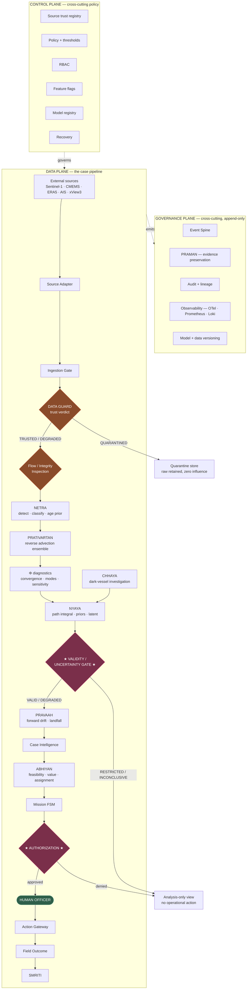
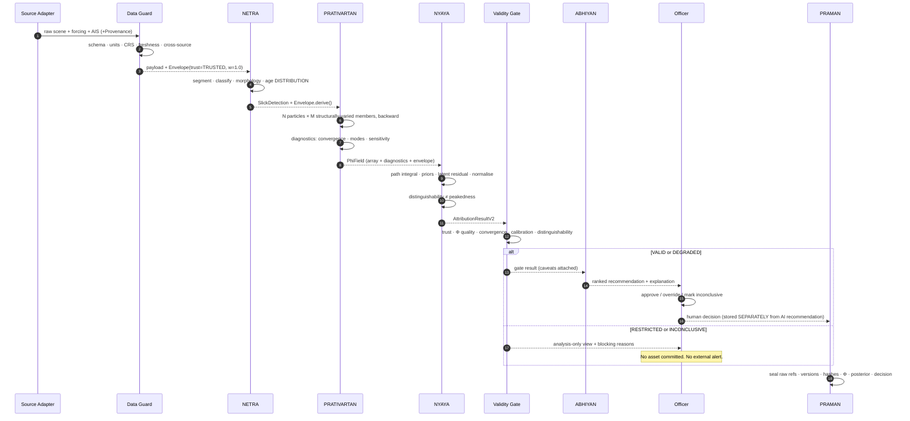
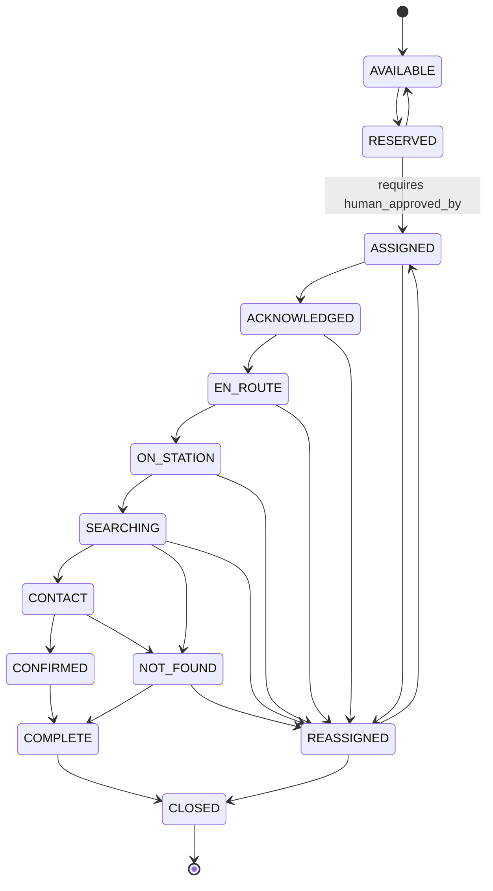
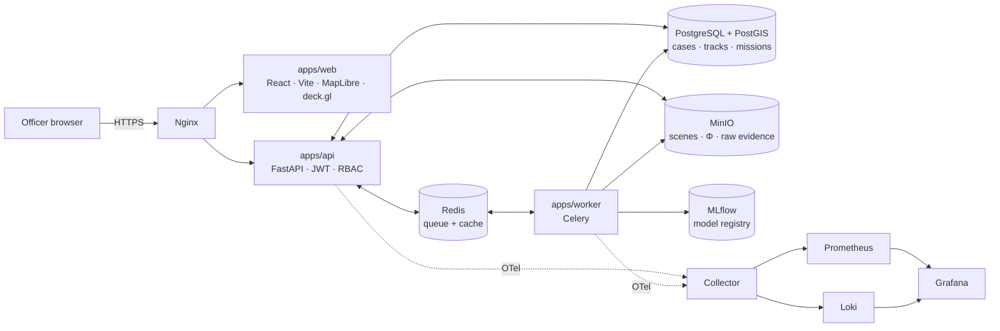

# ARCHITECTURE_V2.md
## VARUNA GRID v2 — Trust-Aware, Fail-Safe Architecture

**Status:** locked. Changes require an ADR in `docs/adr/`.
**Supersedes:** the v1 linear pipeline described in `VARUNA_MASTER_CONTEXT.md` §10.

---

## 1. Why v2 exists

v1 was a linear pipeline: `detect → backtrack → score → present`. It was auditable and
simple, and it had three structural defects that only appear under failure:

| v1 defect | Consequence | v2 fix |
|---|---|---|
| External data entered inference directly | A single bad CMEMS field silently produced a confident wrong origin | Source Adapter + **Data Guard** trust boundary |
| Quality was a scalar "confidence" | A trusted source with a noisy measurement was indistinguishable from a spoofed source with a clean one | **Trust ≠ confidence**, separated in `EvidenceEnvelope` |
| Nothing stopped a weak inference reaching an action | A flat posterior could still task an aircraft | **Validity/Uncertainty Gate** + authorization gate |

The scientific core (RDPA) is unchanged. What changed is everything around it.

---

## 2. Three planes



**Data plane** moves a case forward. **Control plane** decides what is allowed.
**Governance plane** records what happened. A subsystem may read from control and must
emit to governance; it may never write control policy itself.

---

## 3. Trust boundaries

There are exactly four places where the trust level of information can change:

| # | Boundary | Direction | Owner |
|---|---|---|---|
| 1 | **Ingestion Gate → Data Guard** | External → internal. Assigns initial `TrustState`. | ROLE 02 |
| 2 | **Flow Inspection** | Internal → internal. Can *downgrade* on propagation anomalies. | ROLE 02 |
| 3 | **Validity Gate** | Inference → operational. Can *block*. | ROLE 01 |
| 4 | **Authorization Gate** | Recommendation → physical action. Requires a human. | ROLE 04 |

Trust never increases anywhere. `EvidenceEnvelope.derive()` enforces this in code.

---

## 4. Data Guard vs Flow Inspection

Two different questions. Keeping them separate is what makes each one testable.

| | **Data Guard** | **Flow Inspection** |
|---|---|---|
| Question | "Is this source trustworthy?" | "Does this still make sense after propagation?" |
| Runs at | Ingestion | Every module boundary |
| Sees | One source, its history, correlated sources | Two adjacent module outputs |
| Detects | Schema/unit/CRS drift, staleness, outliers, source drift, cross-source conflict, manipulation | Trajectory discontinuity, impossible implied speed, unnormalised Φ, multimodality, stale output, cross-module contradiction |
| Emits | `TrustState` + `influence_weight` | `AnomalyFlag` + possible trust downgrade |

Inspected interfaces: `Data→NETRA`, `NETRA→PRATIVARTAN`, `PRATIVARTAN→NYAYA`,
`NYAYA→ABHIYAN`, `ABHIYAN→Action Gateway`.

---

## 5. Bounded Evidence Influence

> This is **not** PPO and must never be described as clipping. See `docs/adr/ADR-0003`.

Each observation carries `0 ≤ influence_weight ≤ 1`, capped by its trust state:

```
TRUSTED     → 1.0
DEGRADED    → 0.6
CONFLICTED  → 0.3
QUARANTINED → 0.0
```

The **value is never modified**. Only its downstream influence is bounded. This matters
because a legitimate extreme observation — a genuinely unusual current, a real high-speed
transit — must survive. Clipping the value would destroy real signal; bounding influence
preserves it while limiting the damage a compromised source can do.

Quarantined data is retained in full as raw evidence. It simply contributes zero.

---

## 6. Sequence — nominal case



---

## 7. Sequence — degraded case (forcing outage)

```mermaid
sequenceDiagram
  autonumber
  participant SRC as CMEMS Adapter
  participant DG as Data Guard
  participant PV as PRATIVARTAN
  participant NY as NYAYA
  participant VG as Validity Gate
  participant OF as Officer

  SRC->>SRC: live fetch fails (timeout)
  SRC->>SRC: cache miss → climatology fallback
  SRC-->>DG: climatology + Provenance(source_version="climatology")
  DG-->>PV: Envelope(trust=DEGRADED, w=0.6, degradation=FALLBACK_SOURCE)
  PV->>PV: ensemble runs; spread widens materially
  PV-->>NY: PhiField(entropy high, effective_support large)<br/>envelope inherits DEGRADED
  NY->>NY: posterior flattens; distinguishability low
  NY-->>VG: decision_state = NOT_DISTINGUISHABLE
  VG->>VG: forcing uncertainty check FAILS
  VG-->>OF: RESTRICTED — "climatology fallback; origin field unreliable"
  Note over OF: Search box still shown.<br/>No vessel named. No asset dispatched.
```

The system stays useful — it narrows the search — while refusing to name anyone.

---

## 8. Case state — four independent axes

```mermaid
stateDiagram-v2
  direction LR
  state "Investigation" as I {
    [*] --> DETECTED
    DETECTED --> TRIAGED
    TRIAGED --> VERIFIED
    VERIFIED --> RECONSTRUCTED
    RECONSTRUCTED --> ATTRIBUTED
  }
  state "Outcome" as O {
    [*] --> PENDING
    PENDING --> STRONG_LEAD
    PENDING --> WEAK_LEAD
    PENDING --> LATENT
    PENDING --> NOT_DISTINGUISHABLE
    PENDING --> INCONCLUSIVE
  }
  state "Response" as R {
    [*] --> NO_ACTION
    NO_ACTION --> MONITORING
    MONITORING --> RECOMMENDATION_READY
    RECOMMENDATION_READY --> ASSIGNED
    ASSIGNED --> EN_ROUTE --> ON_STATION --> SEARCHING
    SEARCHING --> CONFIRMED
    SEARCHING --> NEGATIVE
    SEARCHING --> REASSIGNED
  }
```

Collapsing these into one enum was the v1 mistake: `ATTRIBUTED` said nothing about
whether an aircraft was airborne, and `CLOSED` said nothing about whether evidence was
preserved. Independent axes make illegal combinations *expressible*, so
`check_case_invariants()` can reject them. Enforced invariants:

- outcome may not be set before `ATTRIBUTED`
- an asset may not be committed on a non-dispatchable outcome
- an asset may not be committed before Φ reconstruction
- a case may not close with no evidence (PRAMAN violation)
- a case may not close while an asset is committed
- `CONFIRMED` response is illegal on an `INCONCLUSIVE` outcome

---

## 9. Mission FSM



`MissionRecord.transition()` validates every edge and raises on `ASSIGNED` without
`human_approved_by`. This is the authorization gate in code.

---

## 10. Φ as a structured object

PRATIVARTAN reports its own uncertainty. NYAYA reads those diagnostics; it does not
re-derive them from the array.

```
PhiField
├── data_path            .npz — locked keys, sum(phi) == 1.0
├── time_distribution    marginal over RELEASE TIME (mode, p05, p95)
├── spatial_modes[]      centroid, mass, area, separation  ← >1 means competing origins
├── diagnostics
│     entropy · concentration · effective_support_km2
│     convergence · convergence_flag · n_modes · multimodal
│     boundary_interaction · particles_lost · ensemble_completeness
└── sensitivity
      age · forcing · diffusivity · weathering  → dominant_assumption
```

`sensitivity` is what makes the honesty claim defensible: if `age_sensitivity` dominates,
the origin field is an artefact of the age prior rather than of the data, and the UI
must say so.

---

## 11. External services and simulation

Every external integration sits behind an adapter with a declared status. See
`SETUP_STATUS.md` §"Real vs Simulated" for the authoritative matrix. Rules:

- A simulated provider **must** be labelled in the UI and in `EvidenceEnvelope.provenance`.
- A simulated provider **must not** be described as an integration in any document.
- Adapters for unavailable systems are written to the interface and marked INTEGRATION-READY, never MOCKED-as-live.

---

## 12. Failure containment map

Every P0/P1 threat in `FAILURE_THREAT_MATRIX.md` is contained at exactly one architectural
location. If a new failure has no containment location, that is an architecture gap and
requires an ADR — not a defensive `try/except` at the call site.

| Failure class | Contained at |
|---|---|
| Bad/hostile external data | Data Guard |
| Correlated source bias | Data Guard (cross-source consistency) |
| Propagation corruption | Flow Inspection |
| Physics non-convergence | Φ diagnostics → Validity Gate |
| Ambiguous attribution | NYAYA `distinguishability` → Validity Gate |
| Unsafe operational action | Validity Gate + Authorization Gate |
| Asset over-commitment | Mission FSM + case invariants |
| Evidence loss | PRAMAN append-only + content hashing |
| Runaway learning | SMRITI human-approval gate |
| Alert spam / wrong audience | Alerts materiality + role router |

---

## 13. Deployment



Single-node Docker Compose, one GPU. Air-gappable: all model weights, forcing NetCDF,
scenes and basemap tiles cached locally. `DEMO_MODE=true` serves frozen artifacts and
never touches an external API.

---

## 14. What is deliberately absent

No Kafka, no Kubernetes, no service mesh, no vector DB, no RAG, no agent framework, no RL
in the core. Each was considered and rejected: at four people and single-node scale they
add operational surface without reducing any risk in the matrix. Re-proposing any of them
requires an ADR that addresses that specific point.

The one permitted LLM use is drafting human-readable incident narratives from structured
outputs, with every number injected rather than generated. It may not touch Φ, posteriors,
trust, assignments, or severity.
