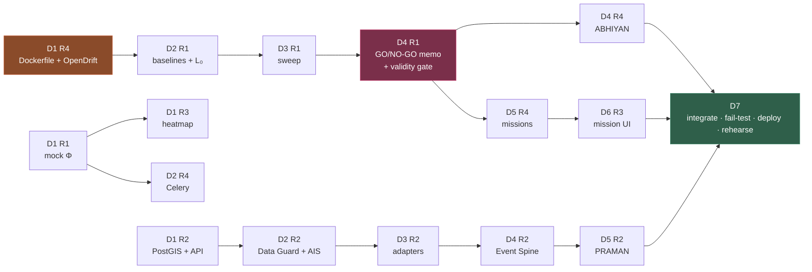

# BUILD_PLAN_7_DAYS.md
## VARUNA GRID v2 — four people, seven days

**Rule:** Day 7 is integration, failure testing, deployment and rehearsal. **No new
features on day 7.** A feature that is not integrated by end of day 6 is cut.

**Rule:** integrate daily. No branch stays unmerged for more than 24 hours.

**Rule:** every task has INPUT → OUTPUT → ACCEPTANCE TEST. If you cannot state the
acceptance test, the task is not ready to start.

| | Role | Owns |
|---|---|---|
| **R1** | Scientific / ML | NETRA · PRATIVARTAN · NYAYA · CHHAYA · calibration |
| **R2** | Data / Backend | Data Guard · adapters · AIS · PostGIS · API · Event Spine · PRAMAN |
| **R3** | Frontend / Geo | Cockpit · map · missions UI · field mode · alerts UI |
| **R4** | MLOps / Ops | PRAVAAH · ABHIYAN · missions · alerts · Docker · CI · SMRITI pipeline |

---

## Day 1 — Foundation and contracts

**Goal:** the repository runs, the contract is locked, and nobody is blocked tomorrow.

| Role | Tasks | Artifacts |
|---|---|---|
| **R1** | Ship mock `PhiField` + `.npz` **before lunch** — R3/R4 depend on it. Then begin the go/no-go rebuild: parameterise hard negatives, give every vessel a full-envelope track. | `packages/varuna_nyaya/mock_phi.py`, updated `experiments/go_nogo/` |
| **R2** | Dockerfile (with R4). PostGIS schema + Alembic. FastAPI skeleton + health. | `apps/api/{main,db,models}.py`, `db/migrations/` |
| **R3** | Vite + TS + Tailwind + MapLibre. Φ heatmap on mock data. Time slider. | `apps/web/` scaffold, `PhiHeatmapLayer.ts` |
| **R4** | **Fix the broken compose stack** (no Dockerfile exists). CI pipeline. **Install and verify OpenDrift backward simulation** — R1 blocked on this by day 2. | `infra/docker/Dockerfile`, `Makefile`, `.github/workflows/ci.yml` |

**Dependencies:** none — all four are parallel.
**Integration criteria:** `docker compose up` starts postgres+redis+minio+api; `make test` green.
**Done when:** clean clone → `make up && make test` passes on every machine.

---

## Day 2 — Physics and data trust

**Goal:** Φ is produced from real physics; external data enters through a trust boundary.

| Role | Tasks | Artifacts |
|---|---|---|
| **R1** | Honest baselines (nearest-vessel, **Cerulean geometric**, single backtrack). Real L₀ via corridor subtraction. Run the delete-the-guilty-track test. | `experiments/baselines/`, `packages/varuna_nyaya/latent.py` |
| **R2** | Data Guard checks + trust scoring (**fails closed**). AIS ingest → `VesselTrack` with gap inflation. Deliver real tracks to R1. | `packages/varuna_data_guard/{checks,trust}.py`, `varuna_source_adapters/{ais,tracks}.py` |
| **R3** | Particle `TripsLayer` at real pace. Vessel `PathLayer`. `TrustBadge` component. | `ParticleTripsLayer.ts`, `VesselTrackLayer.ts`, `TrustBadge.tsx` |
| **R4** | Celery + Redis wired. OpenTelemetry + Prometheus + Grafana + Loki. | `apps/worker/celery_app.py`, `infra/monitoring/` |

**Dependencies:** R1 needs OpenDrift verified (R4, day 1). R3 needs mock Φ (R1, day 1).
**Integration criteria:** a Celery job produces a Φ `.npz` that passes normalisation check.
**Done when:** Φ renders in the browser from a real backend job.

---

## Day 3 — Attribution

**Goal:** the posterior exists, is normalised, and knows when it cannot answer.

| Role | Tasks | Artifacts |
|---|---|---|
| **R1** | Structural forcing bias + spatial shear/eddies. Age sampled from prior. Vectorise path integral. **Launch the full sweep overnight.** | `experiments/forcing_bias/`, sweep CSV |
| **R2** | Source adapters (CMEMS, ERA5) with fallback chain + raw preservation. API routes complete. | `varuna_source_adapters/{cmems,era5,base}.py`, `apps/api/routes/` |
| **R3** | Officer cockpit: suspect table with published prior sub-scores, decision-state banner. | `views/Cockpit.tsx`, `SuspectTable.tsx`, `DecisionStateBanner.tsx` |
| **R4** | PRAVAAH forward drift + named landfall **interval**. | `packages/varuna_pravaah/{forecast,landfall}.py` |

**Dependencies:** R3 needs API shape from R2. R4 needs forcing cache from R2.
**Integration criteria:** `POST /attribute` returns a valid `AttributionResultV2`.
**Done when:** a full case runs detect→Φ→attribute through the API.

---

## Day 4 — Perception and the gate

**Goal:** real SAR in; nothing weak gets out.

| Role | Tasks | Artifacts |
|---|---|---|
| **R1** | **Go/no-go decision memo** from the rebuilt sweep. NYAYA posterior + `distinguishability` + `ValidityGateResult`. Begin NETRA training. | Decision memo, `varuna_nyaya/{posterior,validity_gate}.py` |
| **R2** | Event Spine (ordering enforced). Case management + `check_case_invariants` on every write. Flow Inspection at all five boundaries. | `varuna_domain/{events,cases}.py`, `varuna_data_guard/flow_inspection.py` |
| **R3** | **Judge controls** — toggle transponder, sub-2s round trip. Live API swap. SSE progress. | `JudgeControls.tsx`, TanStack Query client |
| **R4** | ABHIYAN: feasibility filter → value matrix → exact assignment → explanation. | `packages/varuna_abhiyan/` |

**Dependencies:** R4 needs `ValidityGateResult` from R1. R3 needs live API from R2.
**Integration criteria:** an `INCONCLUSIVE` case is blocked from producing a tasking.
**Done when:** the validity gate demonstrably refuses a weak case.

---

## Day 5 — Response and evidence

**Goal:** the loop continues past the answer, and everything is preserved.

| Role | Tasks | Artifacts |
|---|---|---|
| **R1** | NETRA training complete + exported + look-alike FP rate published. Age prior as a distribution. | `models/netra/`, MLflow run, model card |
| **R2** | PRAMAN: deterministic manifests, append-only, content hashing, human/AI separation. | `packages/varuna_praman/` |
| **R3** | Φ diagnostics panel (convergence, modes, `dominant_assumption`). Landfall clock. Alerts UI with SIMULATED badges. | `PhiDiagnosticsPanel.tsx`, `LandfallClock.tsx`, `AlertPanel.tsx` |
| **R4** | Missions FSM + authorization capture. Alert router: materiality → role → policy → freshness → delivery. | `packages/varuna_missions/`, `packages/varuna_alerts/` |

**Dependencies:** R3 needs Φ diagnostics populated (R1, day 2–3).
**Integration criteria:** a manifest re-generates byte-identically; `ASSIGNED` requires approval.
**Done when:** CASE-0001 runs detect → attribute → forecast → task → approve → seal.

---

## Day 6 — Watch, memory, and completeness

**Goal:** the system looks like an operational grid, not a demo script.

| Role | Tasks | Artifacts |
|---|---|---|
| **R1** | CHHAYA with all four `LatentFinding` values. Calibration fit + ECE + reliability diagram. Ablation table. | `packages/varuna_chhaya/`, calibration artifacts |
| **R2** | PRAHARI historical-replay watch. Cross-source consistency + **source dependency registry**. | `apps/worker/prahari.py`, `varuna_data_guard/cross_source.py` |
| **R3** | Missions view, field mode, evidence view, analytics (reliability diagram, accuracy-vs-age). | `views/{Missions,FieldMode,Evidence,Analytics}.tsx` |
| **R4** | SMRITI: history, recurrence, corridors + **retraining pipeline with human-approval gate**. Test that no online path exists. | `packages/varuna_smriti/`, `test_smriti_no_online_training.py` |

**Dependencies:** R3 needs mission + alert APIs (R4, day 5).
**Integration criteria:** every P0 threat has a passing or explicitly-deferred test.
**Done when:** feature freeze. Anything unintegrated is now cut.

---

## Day 7 — Integration, failure, deployment, rehearsal

**No new features. None.**

| Block | Activity | Owner |
|---|---|---|
| 00–03 | Full E2E on CASE-0001 in Docker from a clean clone | all |
| 03–06 | **Failure injection**: walk every P0 row in `FAILURE_THREAT_MATRIX.md`, confirm the degraded behaviour is what the matrix says | R1 + R2 |
| 06–09 | `DEMO_MODE=true` verification — zero external calls; replay mode with backend stopped | R3 + R4 |
| 09–12 | Portable SSD build; **restore and run on a second machine** | R4 |
| 12–15 | `SETUP_STATUS.md` honest final pass; README status pass; remove any unverified claim | all |
| 15–18 | Rehearsal ×3. Record backup video. Q&A drill on the honesty rules | all |

**Done when:** a clean machine with the SSD and no network runs the full demo.

---

## Critical path

**Two hard blockers:**
1. **D1 R4 — Dockerfile + OpenDrift.** Nothing runs and R1 cannot do physics without these.
2. **D4 R1 — the go/no-go memo.** Every claim the team makes downstream depends on that number being honest.

---

## Cut order if behind

| Cut | Drop | Why safe |
|---|---|---|
| 1st | Alert channel adapters beyond Web | Panel + delivery log tell the story |
| 2nd | Field mode | Cockpit covers the demo |
| 3rd | PRAHARI live scheduler | Historical replay looks identical |
| 4th | SMRITI live queries | Pre-computed corridor layer |
| 5th | CHHAYA fine-tuning | Pretrained xView3 as-is |
| **NEVER** | Contracts · Data Guard · Validity Gate · authorization gate · Φ diagnostics · calibration · replay fallback | These are the architecture. Without them it is a different, weaker project. |
