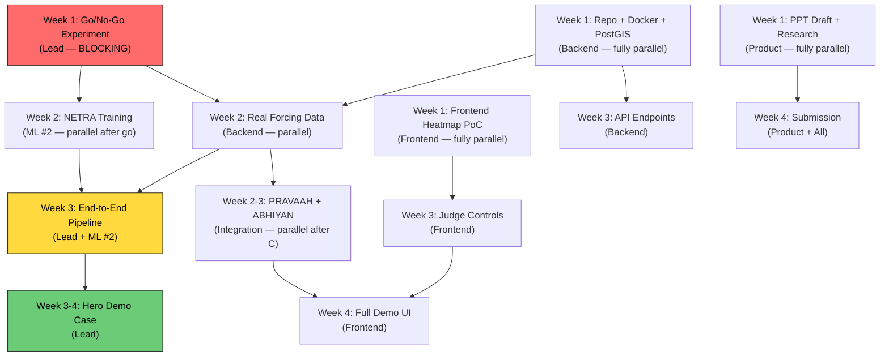

# VARUNA GRID — Execution Roadmap & Strengthening Brief
## SIH 2026 · SIH26143 · Prepared 23 Aug 2026

---

## 1. WEEK-BY-WEEK ACTION PLAN

> **Today is 23 Aug 2026. Idea submission deadline: 20 Sep 2026 (28 days). Grand Finale: December 2026 (~16 weeks).**

### Phase 1: Proof of Concept & Submission (Weeks 1–4: 23 Aug → 20 Sep)

#### WEEK 1 (23–30 Aug) — THE GO/NO-GO WEEK ★★★

This is the single most important week. Everything else is contingent.

| Day | Task | Owner | Deliverable |
|-----|------|-------|-------------|
| **Day 1–2** | **Go/No-Go Experiment Setup** — Install OpenDrift. Create synthetic uniform current field (0.3 m/s, rotating ±15° over 48h). Seed 500 particles at a known release point. Advect forward 24h → capture "observed slick" mask. Set up backward ensemble with M=10 perturbed forcing realisations (wind-drift coeff ∈ [0.02, 0.04], diffusivity ∈ [5, 50 m²/s]) | Lead (ML/architect) | Working forward+backward OpenDrift script |
| **Day 2–3** | Generate K=20 synthetic AIS tracks (straight-line + loiter + curve patterns, realistic speeds 8–18 kt) in the same bbox. One track passes through the true release point. Compute path-integral likelihood for each. | Lead | Python script: `sweep_discriminability.py` |
| **Day 3–5** | **Sweep the grid:** slick age ∈ {2, 6, 12, 24, 48h} × traffic density ∈ {5, 10, 20, 50} × forcing error ∈ {low, medium, high}. 100 Monte Carlo trials per cell. Plot top-1 and top-3 accuracy vs baseline (nearest-vessel). | Lead | **The curve.** This is the single most important plot in the entire project. |
| **Day 5–6** | Compute the latent-source test: delete the guilty track, measure L₀ residual detection rate. | Lead | False-negative and false-positive rates for dark-vessel hypothesis |
| **Day 7** | **GO/NO-GO DECISION.** If top-1 at 24h/20 vessels < 40% AND not improving with M → pivot (see §6). If ≥ 50% → green light. 40–50% → conditional go with emission priors. | Lead + full team | Decision recorded in a 1-page memo |

**In parallel (Week 1):**

| Task | Owner | Notes |
|------|-------|-------|
| Register Copernicus Data Space + CMEMS + CDS (ERA5) accounts | Backend | 5 min each, but verification can take 24h |
| Download Zenodo Parts I–III (40+ GB) | ML #2 | Start immediately — large download |
| Download ESSD look-alike dataset from PANGAEA | ML #2 | The most valuable training dataset |
| Apply for Krestenitis/MKLab dataset (needs institutional email + abstract) | Product/Demo | Requires supervisor signature |
| **Obtain the MPB 2024 paper** (PMID 39146713) via college library / Sci-Hub | Lead or Product | **CRITICAL.** Must read before any novelty claim is finalised |
| Frontend: install MapLibre GL + deck.gl, render a basic heatmap layer over an ocean basemap | Frontend | Prove the rendering pipeline works on day 1 |
| Set up the project repo structure, Docker Compose skeleton, PostGIS container | Backend | Foundation for everything else |

> [!IMPORTANT]
> **The MPB 2024 paper** ("A new ship tracing technology from oil spills based on multi-source data", Luo et al.) uses a **bidirectional Lagrangian drift model** to compute trajectory similarity between suspected vessels and oil spill drift. Web search confirms it does NOT use ensemble uncertainty, path-integral scoring, latent-source hypothesis, or calibrated posteriors. **Your core RDPA mechanism remains differentiated**, but you MUST read the full paper to confirm this and cite it properly. Their "average similarity" metric is a deterministic comparator — fundamentally different from your probabilistic formulation.

---

#### WEEK 2 (30 Aug → 6 Sep) — NETRA TRAINING + REAL FORCING DATA

| Task | Owner | Deliverable |
|------|-------|-------------|
| **NETRA training run** — U-Net with EfficientNet-B2 encoder via `segmentation_models_pytorch`. Input: 2-channel (VV+VH) + ERA5 10m wind as 3rd channel. Train on Zenodo + ESSD. Binary + look-alike multi-class head. | ML #2 | Trained weights, IoU on test split, FP rate on look-alikes |
| Download CMEMS currents (reanalysis `GLOBAL_MULTIYEAR_PHY_001_030`) for 3 demo regions: (a) Arabian Sea / Mumbai High, (b) Bay of Bengal / Chennai, (c) Gulf of Mexico (for real AIS validation) | Backend | Cached NetCDF files (~2–5 GB per region/month) |
| Download ERA5 10m wind for same regions/periods | Backend | Cached GRIB/NetCDF |
| Download MarineCadastre AIS for Gulf of Mexico (1 month, ~2 GB CSV) — this is your REAL traffic geometry validation | Backend | Cleaned AIS tracks in PostGIS |
| Upgrade go/no-go experiment to use **real CMEMS currents** instead of synthetic. Re-run the sweep on the Gulf of Mexico with real AIS. | Lead | Updated accuracy-vs-age curve with real physics |
| Frontend: render animated particle trails (deck.gl `TripsLayer` or custom particle shader). Get 5,000 particles moving on screen smoothly. | Frontend | The "backward bloom" prototype |

> [!TIP]
> **GPU for NETRA training**: A single NVIDIA T4/A10 (16 GB) is sufficient for U-Net with EfficientNet-B2 on 512×512 tiles. Training time: ~4–8 hours on Zenodo dataset. Use Google Colab Pro ($12/mo) or Kaggle free GPU (30 hrs/week) if no local GPU. Export to TorchScript immediately after training.

---

#### WEEK 3 (6–13 Sep) — END-TO-END PIPELINE + HERO CASE

| Task | Owner | Deliverable |
|------|-------|-------------|
| Wire NETRA → PRATIVARTAN → NYAYA end-to-end on a single real SAR scene (a known oil spill from Zenodo) | Lead + ML #2 | Working pipeline: SAR → mask → Φ → posterior |
| Build the **hero demo case**: pick the best Gulf of Mexico spill scene with real AIS. Run full RDPA. Freeze all cached data. | Lead | The case that will be shown in every round |
| Implement emission prior (M8): vessel type weighting + AIS gap penalty + speed anomaly scoring | Lead | Prior vector for each candidate vessel |
| Implement PRAVAAH: forward drift from current slick position, geocode landfall against coastline | Integration | "Oil reaches [Beach Name] in Xh Ym" |
| Build the judge-controls UI: click a vessel → toggle transponder → re-run posterior | Frontend | **THE highest-leverage demo feature** |
| Draft the idea submission PPT (10 slides max per SIH format) | Product/Demo | First complete draft |

---

#### WEEK 4 (13–20 Sep) — SUBMISSION POLISH + SECOND CASE

| Task | Owner | Deliverable |
|------|-------|-------------|
| Build a **second demo case** (different region, different difficulty) to prove generalization | Lead | Two working end-to-end cases |
| Implement CHHAYA: run xView3 detector on the same SAR scene, cross-ref with AIS to find dark objects | ML #2 | Dark vessel detections overlaid on map |
| Implement SMRITI hotspot layer: pre-compute a static "pollution corridor" heatmap from 6+ months of Zenodo detections | Backend | The "pattern reveal" moment |
| Finalize and submit the idea PPT | Product/Demo + all | **Submitted by 20 Sep** |
| Record a 3-minute backup demo video | Product/Demo | Insurance against demo failure |
| Internal college hackathon preparation (if required) | All | Presentation + live demo ready |

---

### Phase 2: Pre-Screening & Build-Out (Weeks 5–12: Oct–Nov)

After idea submission, you have 8–10 weeks before the grand finale. This is where you build production quality.

#### WEEKS 5–6: HARDENING

| Task | Owner |
|------|-------|
| Add calibration layer (M10): run 500+ simulated cases through the pipeline, fit isotonic regression, report ECE | Lead |
| Generate the **accuracy-vs-slick-age curve** (the evidence slide) with proper baselines: nearest-vessel, Cerulean-style geometric, single deterministic backtrack | Lead |
| Implement reliability diagrams | Lead |
| Ablation study: ensemble vs single trajectory, path-integral vs nearest-point, ± emission prior, ± latent term, ± wind channel | Lead + ML #2 |
| Build 5–8 additional demo cases spanning easy → hard → inconclusive | Lead + Backend |

#### WEEKS 7–8: WORKFLOW COMPLETENESS

| Task | Owner |
|------|-------|
| ABHIYAN greedy asset tasking: given Φ + available asset endurance → optimal search box | Integration |
| SETU alert panel: mock SMS/notification UI showing multilingual alerts | Frontend |
| PRAMAN evidence manifest: one-click case file with model versions, forcing versions, Φ snapshot, checksums | Backend |
| PRAHARI mock scheduler: show the "always-on watch" concept even if not live-ingesting | Backend |
| Stress tests: AIS gaps (20–120 min), current field error injection, overlapping slicks | Lead |

#### WEEKS 9–10: DEMO ENGINEERING

| Task | Owner |
|------|-------|
| Engineer all 6 demo moments (§15.1) with precise timing | Product/Demo + Frontend |
| Build the "wrong answer first" baseline comparison into the demo flow | Lead + Frontend |
| Add the inconclusive case with honest "INCONCLUSIVE" output | Lead |
| Landfall countdown timer with live animation | Frontend |
| Rehearse the full 10-minute presentation 5+ times | All |

#### WEEKS 11–12: POLISH & FAILSAFE

| Task | Owner |
|------|-------|
| Performance optimization: ensure Φ computation < 2 min on demo hardware | Lead + Backend |
| Build fallback replay mode: if GPU dies, play pre-computed animation from cached Φ | Frontend |
| Q&A preparation: 50 hardest questions with prepared answers (see §3 below) | All |
| Record final backup video (full 10-minute demo) | Product/Demo |
| Pack all Docker images, cached data, and weights onto a portable SSD | Backend |

### Phase 3: Grand Finale (December 2026, 36 hours)

Follow the plan in your Section 16.3 exactly. The key additions:

| Hour Block | Critical Action |
|------------|----------------|
| **0–2** | Set up hardware. Verify GPU. Load Docker images from SSD. Run hero case end-to-end. If anything fails, switch to replay mode immediately. |
| **2–6** | Wire remaining subsystems. Get NYAYA + PRATIVARTAN running live. |
| **6–12** | Frontend polish. Judge controls working perfectly. |
| **12–18** | R1 presentation. Incorporate feedback. |
| **18–24** | PRAVAAH + ABHIYAN + SMRITI integration. |
| **24–30** | R2/R3 presentations. Polish based on mentor feedback. |
| **30–36** | Final rehearsal. Record backup. Rest before finale. |

---

## 2. TEAM TASK ALLOCATION

### Role Assignments (6 people)

```
┌─────────────────────────────────────────────────────────────────────┐
│                        TEAM STRUCTURE                               │
├─────────────────────────────────────────────────────────────────────┤
│                                                                     │
│  PERSON 1: LEAD (ML/Architect) ─── PRATIVARTAN + NYAYA + M10       │
│  ├── Owns the core mechanism (ensemble → Φ → path-integral)        │
│  ├── Go/no-go experiment                                            │
│  ├── Calibration + evaluation harness                               │
│  └── Technical Q&A anchor                                           │
│                                                                     │
│  PERSON 2: ML ENGINEER ─── NETRA + CHHAYA + M3                     │
│  ├── U-Net training on Zenodo + ESSD                                │
│  ├── Look-alike rejection head                                      │
│  ├── xView3 dark-vessel detector integration                        │
│  └── Slick characterisation (age prior)                             │
│                                                                     │
│  PERSON 3: BACKEND / DATA ─── PRAHARI + M6 + SMRITI + PRAMAN       │
│  ├── PostGIS schema + AIS ingest pipeline                           │
│  ├── Data downloads (CMEMS, ERA5, AIS, SAR scenes)                  │
│  ├── FastAPI endpoints + job queue (Celery/RQ)                      │
│  ├── Evidence manifest generation                                   │
│  └── Recidivism / hotspot queries                                   │
│                                                                     │
│  PERSON 4: FRONTEND ─── M14 Console + ALL VISUAL MOMENTS            │
│  ├── MapLibre + deck.gl setup                                       │
│  ├── Φ heatmap rendering (HeatmapLayer)                             │
│  ├── Particle animation (backward bloom)                            │
│  ├── Judge controls (click-to-toggle transponder)                   │
│  ├── Landfall countdown                                             │
│  └── Fallback replay mode                                           │
│                                                                     │
│  PERSON 5: INTEGRATION / SYSTEMS ─── PRAVAAH + ABHIYAN + SETU      │
│  ├── Forward drift + landfall geocoding                             │
│  ├── Asset tasking optimiser (greedy/LP)                            │
│  ├── Alert fan-out panel                                            │
│  ├── Docker Compose orchestration                                   │
│  └── Performance optimisation                                       │
│                                                                     │
│  PERSON 6: PRODUCT / DEMO / RESEARCH ─── Narrative + Evidence       │
│  ├── Storyboard the 6 moments                                      │
│  ├── PPT design and submission                                      │
│  ├── Obtain MPB 2024 paper + Krestenitis dataset application        │
│  ├── Rehearsal coach                                                │
│  ├── Backup video recording                                         │
│  └── Q&A prep document                                              │
│                                                                     │
└─────────────────────────────────────────────────────────────────────┘
```

### Dependency Chain vs. Parallelism



**Hard dependencies (serial):**
1. Go/no-go → everything (if no-go, pivot)
2. CMEMS/ERA5 data downloaded → real-forcing experiments + PRATIVARTAN
3. NETRA trained → end-to-end pipeline wiring
4. Φ computation working → NYAYA path-integral scoring
5. NYAYA working → calibration layer

**Fully parallelisable from day 1:**
- Frontend heatmap/particle rendering (uses mock data)
- PostGIS schema + AIS ingest pipeline
- PPT drafting + research (MPB paper, prior art)
- Dataset downloads
- Krestenitis dataset application

---

## 3. PITCH HARDENING — 5 WEAKEST POINTS & PREEMPTIONS

### Attack Point 1: "Your validation is entirely simulated — how do you know it works on real oceans?"

> **Severity: HIGH.** This is the single most predictable judge question.

**Preemption strategy:**
- **Acknowledge it explicitly on the slide.** "Our evaluation measures whether the *inference mechanism* is sound given correct physics. It does not validate whether CMEMS currents match the real Bay of Bengal. That validation requires operational deployment, which is beyond this hackathon's scope."
- **Show that you used real forcing data** (CMEMS reanalysis + ERA5), not toy currents. The physics is real; the ground-truth assignment is synthetic.
- **Show the Gulf of Mexico validation**: use real AIS from MarineCadastre + real CMEMS currents + real ERA5. The only synthetic element is the spill placement, which is the one thing you need ground truth for.
- **Cite the precedent**: "This is identical to how HELCOM Seatrack Web was validated — they test the drift model against known drifter buoy data, but attribution accuracy can only be measured through simulation because confirmed prosecutions are not public."
- **Add one sentence**: "We publish the failure cases where the posterior is flat — no team that hides failures should be trusted with an enforcement tool."

### Attack Point 2: "You haven't read the MPB 2024 paper — how can you claim novelty?"

> **Severity: MEDIUM-HIGH.** A well-read judge or NTRO analyst may know this paper.

**Preemption strategy:**
- **Read it before submission.** This is non-negotiable. Get it through your college library, inter-library loan, or the corresponding author (Dan Luo, likely at a Chinese university — a polite email requesting a preprint often works).
- **Based on the abstract** (which web search has confirmed): Luo et al. use a **deterministic bidirectional Lagrangian drift model** to compute "average similarity" between vessel trajectories and spill drift. This is fundamentally a **single-trajectory, deterministic comparator** — no ensemble uncertainty, no probability field, no latent-source hypothesis, no calibrated posteriors.
- **Your differentiation survives**: (i) ensemble uncertainty over forcing parameters, (ii) 4-D origin probability field Φ, (iii) path-integral likelihood rather than trajectory similarity, (iv) explicit dark-vessel hypothesis L₀, (v) calibration with ECE reporting.
- **In the PPT, cite it**: "Luo et al. (2024) demonstrated bidirectional Lagrangian drift for trajectory similarity scoring. We extend this paradigm by treating the source as a probability field under ensemble uncertainty, competing named vessels against an explicit unobserved-source hypothesis."

### Attack Point 3: "Your AIS data is synthetic for India — this is a toy system"

> **Severity: MEDIUM.** The PS explicitly permits synthetic AIS, but judges still may push on this.

**Preemption strategy:**
- **State it on the slide.** Literally: "Indian EEZ AIS is restricted. The PS permits synthetic data. We developed on real US AIS (MarineCadastre) with real traffic geometry and validated on synthetic Indian-EEZ traffic."
- **Show that the algorithm is AIS-agnostic.** The path integral works on any trajectory format. Swapping data sources is a configuration change, not an architecture change.
- **Frame it as the deployment proposal:** "In an operational deployment, VARUNA would connect to the ICG's existing AIS feed or ISRO's NavIC-AIS payload. The algorithm is ready; the data pipeline is a procurement decision."
- **Show the US AIS validation prominently.** Real vessels, real speeds, real gap patterns. This proves the algorithm handles real traffic geometry.

### Attack Point 4: "How is this different from Cerulean? They're open-source and operational."

> **Severity: HIGH.** Any judge who Googles will find Cerulean in 30 seconds.

**Preemption strategy:**
- **Never claim Cerulean doesn't exist.** Honesty Rule #1.
- **Use the demo to show the difference.** The "wrong answer first" moment (Demo Moment 1) literally runs the Cerulean-style geometric baseline, watches it fail on an 18-hour slick, then runs VARUNA. The difference is *visible*.
- **One-liner**: "Cerulean answers 'which ship is alongside this slick?' VARUNA answers 'which ship passed through the place this slick came from.' Cerulean's own methods page disclaims drift modelling. We start where they stop."
- **Show the accuracy-vs-age curve.** Both approaches should be on the same plot. Cerulean-style accuracy drops after ~6h. VARUNA's holds to 24h+. This is the evidence slide.

### Attack Point 5: "You claim calibrated probabilities — how do you calibrate without real ground truth?"

> **Severity: MEDIUM.** This is the most technically sophisticated attack.

**Preemption strategy:**
- **Be precise about what calibration means here.** "We calibrate on *simulated* ground truth — thousands of cases where we know the true source by construction. Isotonic regression maps our raw posteriors to frequencies that match observed outcomes in simulation."
- **Acknowledge the gap:** "This calibration is valid *given* the physics model. If the physics model is biased (e.g., CMEMS currents systematically misalign with real conditions), the calibration inherits that bias. This is stated in our evidence manifest."
- **Show the reliability diagram.** Plot predicted probability vs observed frequency. If this is flat diagonal-ish, you've won the argument. No other SIH26143 team will have this.
- **Report ECE.** A single number that quantifies calibration quality. If ECE < 0.05, you can say "when we say 0.7, it is 0.7 within 5 percentage points."

---

## 4. INFRASTRUCTURE & TOOLING CHECKLIST

### 4.1 Compute Requirements

| Component | GPU Need | Estimate | Options |
|-----------|----------|----------|---------|
| **NETRA training** (U-Net EfficientNet-B2) | Yes — 1× GPU, 16 GB VRAM | 4–8 hours on Zenodo (~1,200 images) | Google Colab Pro ($12/mo, T4/A100), Kaggle Free (30 hrs/wk P100), local GPU if available |
| **NETRA inference** | Optional — runs on CPU in ~2s/tile | At demo: 5–10 tiles per case | CPU is fine for demo |
| **xView3 (CHHAYA)** | Yes for training, no for inference | Inference: ~1s/tile on GPU, ~5s CPU | Use AllenAI pretrained weights — no training needed |
| **OpenDrift ensemble** (PRATIVARTAN) | No GPU — CPU-bound, multicore | N=5000 particles × M=50 members × 24h = ~2–5 min on 8 cores | Any modern laptop with 8+ cores |
| **Path-integral scoring** (NYAYA) | No — pure NumPy | Milliseconds | Any CPU |
| **Calibration sweep** (500+ cases) | CPU-bound, embarrassingly parallel | ~4–8 hours with 8 cores | Run overnight |
| **Demo day** | 1× GPU for NETRA inference speed | NVIDIA T4/RTX 3060+ | Bring your own laptop with GPU, or cloud fallback |

> [!TIP]
> **Total GPU cost for the entire project: ~$20–50** (Colab Pro for 1–2 months). If your college has any NVIDIA GPU (even GTX 1660 Ti, 6 GB), NETRA can train on 256×256 tiles with a smaller batch size.

### 4.2 Storage

| Component | Size | Format | Storage |
|-----------|------|--------|---------|
| Zenodo dataset (Parts I–III) | ~45 GB | TIFF | Local SSD |
| ESSD look-alike dataset | ~5 GB | NetCDF/patches | Local SSD |
| MarineCadastre AIS (1 month Gulf of Mexico) | ~2 GB | CSV → PostGIS | PostGIS |
| CMEMS currents (3 regions × 1 month) | ~5–15 GB | NetCDF | Local SSD |
| ERA5 wind (3 regions × 1 month) | ~2–5 GB | GRIB/NetCDF | Local SSD |
| SAR scenes for demo (3–5 scenes) | ~5 GB | GeoTIFF | Local SSD |
| Pre-computed Φ fields (hero cases) | ~500 MB | NumPy/NetCDF | Local SSD |
| **Total** | **~80 GB** | | **256 GB SSD is sufficient** |

### 4.3 Database & Object Storage Setup

```yaml
# docker-compose.yml (core services)
version: '3.8'
services:
  postgres:
    image: postgis/postgis:16-3.4
    environment:
      POSTGRES_DB: varuna
      POSTGRES_PASSWORD: ${DB_PASSWORD}
    ports: ["5432:5432"]
    volumes: ["pgdata:/var/lib/postgresql/data"]

  minio:
    image: minio/minio:latest
    command: server /data --console-address ":9001"
    environment:
      MINIO_ROOT_USER: varuna
      MINIO_ROOT_PASSWORD: ${MINIO_PASSWORD}
    ports: ["9000:9000", "9001:9001"]
    volumes: ["miniodata:/data"]

  redis:
    image: redis:7-alpine
    ports: ["6379:6379"]

  api:
    build: ./backend
    ports: ["8000:8000"]
    depends_on: [postgres, minio, redis]
    deploy:
      resources:
        reservations:
          devices:
            - driver: nvidia
              count: 1
              capabilities: [gpu]

volumes:
  pgdata:
  miniodata:
```

### 4.4 API/Dataset Access — Register NOW

| Service | Registration URL | Time to Access | Priority |
|---------|-----------------|----------------|----------|
| **Copernicus Data Space** (Sentinel-1 SAR) | https://dataspace.copernicus.eu/ | Free, instant after email verify | ★★★ |
| **CMEMS** (ocean currents) | https://data.marine.copernicus.eu/ | Free, instant after email verify | ★★★ |
| **CDS / ERA5** (wind) | https://cds.climate.copernicus.eu/ | Free, may take 24h for API key | ★★★ |
| **MarineCadastre AIS** | https://marinecadastre.gov/accessais/ | Free, no registration, direct download | ★★★ |
| **Zenodo datasets** | Direct download links in §12 | Free, instant | ★★★ |
| **PANGAEA (ESSD look-alikes)** | https://doi.org/10.1594/PANGAEA.980773 | Free, instant | ★★★ |
| **Krestenitis/MKLab dataset** | https://m4d.iti.gr/oil-spill-detection-dataset/ | Requires application + institutional email | ★★☆ |
| **xView3 competition data** | https://iuu.xview.us/ | Registration required | ★★☆ |

### 4.5 What MUST Be Real vs. What Can Be Stubbed

| Component | Must Be Real | Can Be Stubbed/Mocked |
|-----------|-------------|----------------------|
| **SAR imagery** (Zenodo) | ✅ Real Sentinel-1 data | — |
| **CMEMS currents** | ✅ Real reanalysis data | — |
| **ERA5 wind** | ✅ Real reanalysis data | — |
| **NETRA segmentation** | ✅ Real trained model | — |
| **OpenDrift backward ensemble** | ✅ Real physics engine | — |
| **Path-integral scoring** | ✅ Real computation | — |
| **AIS data (US/Gulf of Mexico)** | ✅ Real MarineCadastre | — |
| **AIS data (Indian EEZ)** | — | ✅ Synthetic, PS permits it |
| **PRAHARI live ingestion** | — | ✅ Pre-ingest scenes, describe watch |
| **SETU SMS alerts** | — | ✅ Mock UI panel, no real SMS |
| **ABHIYAN asset database** | — | ✅ Hardcoded 3 assets (Dornier, OPV, station boat) |
| **SMRITI hotspot map** | — | ✅ Pre-computed static layer |
| **PRAMAN evidence pack** | ✅ Real checksums + versions | Narrative text can be templated |

### 4.6 Python Environment

```txt
# requirements.txt (core)
torch>=2.0
segmentation-models-pytorch>=0.3
opendrift>=1.11
rasterio>=1.3
geopandas>=0.14
xarray>=2024.1
netCDF4>=1.6
shapely>=2.0
pyproj>=3.6
pandas>=2.1
numpy>=1.26
scipy>=1.12
scikit-learn>=1.4
fastapi>=0.110
uvicorn>=0.29
celery>=5.3
redis>=5.0
psycopg2-binary>=2.9
sqlalchemy>=2.0
geoalchemy2>=0.15
minio>=7.2
onnxruntime>=1.17
copernicusmarine>=1.3
```

---

## 5. DEMO ARCHITECTURE — MINIMAL BUT IMPRESSIVE

### 5.1 Architecture Diagram

```
┌──────────────────────────────────────────────────────────────┐
│                      BROWSER (React SPA)                      │
│  ┌─────────────┐  ┌──────────────┐  ┌────────────────────┐  │
│  │ MapLibre GL  │  │  deck.gl      │  │  React Components  │  │
│  │ (base map)   │  │  Overlays:    │  │  - Case panel      │  │
│  │              │  │  - HeatmapLayer│  │  - Suspect table   │  │
│  │              │  │    (Φ field)   │  │  - Reliability diag│  │
│  │              │  │  - TripsLayer  │  │  - Judge controls  │  │
│  │              │  │    (particles) │  │  - Landfall clock  │  │
│  │              │  │  - PathLayer   │  │  - Alert panel     │  │
│  │              │  │    (AIS tracks)│  │  - Evidence pack   │  │
│  └─────────────┘  └──────────────┘  └────────────────────┘  │
└──────────────────────────┬───────────────────────────────────┘
                           │ REST / WebSocket
┌──────────────────────────┴───────────────────────────────────┐
│                    FastAPI Backend (Python)                    │
│  ┌────────────┐  ┌────────────┐  ┌─────────────────────────┐│
│  │ /api/case   │  │ /api/run    │  │  WebSocket: progress    ││
│  │  CRUD       │  │  trigger    │  │  + live particle data   ││
│  └────────────┘  └─────┬──────┘  └─────────────────────────┘│
│                         │                                     │
│  ┌──────────────────────┴────────────────────────────────────┐│
│  │              Celery Worker (GPU-enabled)                    ││
│  │  ┌────────┐ ┌───────────┐ ┌──────┐ ┌────────┐ ┌────────┐ ││
│  │  │ NETRA  │ │PRATIVARTAN│ │NYAYA │ │PRAVAAH │ │CHHAYA  │ ││
│  │  │ (torch)│ │(OpenDrift) │ │(numpy)│ │(OD fwd)│ │(xView3)│ ││
│  │  └────────┘ └───────────┘ └──────┘ └────────┘ └────────┘ ││
│  └───────────────────────────────────────────────────────────┘│
└──────────────────────────┬───────────────────────────────────┘
                           │
        ┌──────────────────┼──────────────────┐
        │                  │                  │
   ┌────┴────┐      ┌─────┴─────┐      ┌────┴────┐
   │PostGIS  │      │  MinIO    │      │  Redis  │
   │tracks,  │      │  scenes,  │      │  job    │
   │cases,   │      │  Φ fields,│      │  queue  │
   │hotspots │      │  evidence │      │         │
   └─────────┘      └───────────┘      └─────────┘
```

### 5.2 Serving the Φ Heatmap

The Φ field is a 3D array `Φ(x, y, t)`. For the demo:

1. **Backend**: After PRATIVARTAN computes Φ, downsample to ~200×200 spatial grid, discretize time into 1-hour bins. Serialize as JSON array of `{lat, lng, weight, time}` points. Store in MinIO.
2. **Frontend**: Fetch the Φ data via REST. Use deck.gl's `HeatmapLayer` for the spatial view. Use a time slider to animate through temporal slices.

```javascript
// Φ heatmap layer (deck.gl)
new HeatmapLayer({
  id: 'phi-heatmap',
  data: phiData.filter(d => d.time <= currentTime),
  getPosition: d => [d.lng, d.lat],
  getWeight: d => d.weight,
  radiusPixels: 40,
  intensity: 1.5,
  threshold: 0.05,
  colorRange: [
    [255, 255, 178],  // pale yellow
    [254, 204, 92],
    [253, 141, 60],
    [240, 59, 32],
    [189, 0, 38],     // deep red
  ],
});
```

### 5.3 Animated Particle Trails (The Backward Bloom)

Use deck.gl's `TripsLayer` to animate backward particle trajectories:

```javascript
// Backward particle animation
new TripsLayer({
  id: 'backward-particles',
  data: particleTrails, // Array of {path: [[lng,lat,t], ...], ...}
  getPath: d => d.path,
  getTimestamps: d => d.timestamps,
  getColor: [0, 200, 255],    // cyan glow
  opacity: 0.6,
  widthMinPixels: 2,
  trailLength: 600,           // trail fade length in seconds
  currentTime: animationTime, // increment this in requestAnimationFrame
});
```

**Animation loop:**
```javascript
function animate() {
  animationTime += 60; // advance 1 minute per frame
  if (animationTime > maxTime) return;
  deckOverlay.setProps({ layers: [heatmapLayer, tripsLayer] });
  requestAnimationFrame(animate);
}
```

### 5.4 Tech Stack Summary

| Layer | Choice | Why |
|-------|--------|-----|
| **Frontend framework** | React 18 + Vite | Fast dev, team likely knows it |
| **Map** | MapLibre GL JS v4 (free, no API key) | No Mapbox token needed at demo |
| **Data viz** | deck.gl v9 (`@deck.gl/mapbox` overlay) | HeatmapLayer + TripsLayer handle Φ + particles |
| **Charts** | Recharts or Nivo | Reliability diagrams, accuracy curves |
| **Backend** | FastAPI + Celery + Redis | Async job queue for long-running drift computation |
| **DB** | PostGIS 16 | Spatial queries on tracks, cases |
| **Object store** | MinIO | SAR scenes, Φ fields, evidence packs |
| **ML serving** | TorchScript in-process | No separate model server needed |
| **Containerisation** | Docker Compose | Single `docker compose up` for entire stack |

> [!IMPORTANT]
> **Free basemap tiles**: Use MapLibre with free tile sources:
> - OpenFreeMap: `https://tiles.openfreemap.org/styles/positron` (no API key)
> - Or self-host MBTiles for air-gapped demo (download a regional tile pack beforehand)

---

## 6. RISK-ADJUSTED FALLBACK PLAN

### If the Go/No-Go Fails (Flat Posterior at 24h/20 vessels)

**Diagnosis first:** Before pivoting, understand *why* the posterior is flat:

| Failure Mode | Diagnosis | Targeted Fix |
|-------------|-----------|--------------|
| **Φ too wide spatially** (origin field covers 60+ km) | Current uncertainty dominates → all tracks cross the field | Narrow the age prior (restrict to fresher slicks, 6–12h); increase ensemble size M; use higher-resolution currents if available |
| **Too many tracks scoring equally** | Traffic density swamps discrimination | Add stronger emission priors (vessel type, speed profile, AIS gaps) to break ties |
| **Forcing error too large** | Perturbation range is unrealistic | Calibrate perturbation ranges against real drifter buoy validation data |
| **Path integral is smooth everywhere** | Integration window is too wide temporally | Sharpen the temporal kernel — weight by age prior more aggressively |

**If targeted fixes don't work after 3 days:**

### PIVOT: "Attribution-Aware Detection" (preserves 70% of existing work)

Reframe the system as: **VARUNA detects spills, estimates their origin region, and provides a prioritised vessel shortlist with honest uncertainty — designed for the Indian EEZ's sparse-revisit reality.**

**What you keep:**
- ✅ NETRA (slick detection + look-alike rejection) — unchanged
- ✅ PRATIVARTAN (backward drift) — keep as "origin region estimation" even if the field is wide
- ✅ PRAVAAH (forward drift / landfall forecast) — unchanged
- ✅ CHHAYA (dark vessel detection) — unchanged
- ✅ SMRITI (hotspot memory) — unchanged
- ✅ The entire frontend and demo architecture
- ✅ 6 of 8 subsystems survive

**What changes:**
- ❌ NYAYA drops the "calibrated posterior" claim → becomes "ranked shortlist with geometric + drift-augmented scoring" (essentially Cerulean + drift, which is still better than Cerulean alone)
- ❌ The latent-source hypothesis becomes a simpler "no vessel in origin region" flag
- ❌ The accuracy-vs-age evidence slide becomes "origin field tightness vs age" — still valuable, less dramatic

**New positioning:**
> "We cannot always name the ship. But we can always narrow the search — from the entire ocean to a box a Dornier can fly in two hours. That search box gets tighter as satellite revisit improves, and our system is the first designed to exploit that improvement."

**This is still a strong SIH entry.** It's not the "probabilistic attribution" moonshot, but it's a complete, honest, operational pipeline that no other SIH26143 team will match in breadth.

### If NETRA Training Fails (IoU < 0.5 on test split)

- **Fallback 1:** Use Cerulean's pretrained ResNet34-UNet weights (Apache-2.0) as the segmentation backbone. Fine-tune only the last layer on Zenodo.
- **Fallback 2:** Use a simpler threshold + morphology pipeline on calibrated σ₀ with wind gating. Less accurate, but interpretable and fast.
- **The detection is not your innovation.** An adequate detector is sufficient; a perfect one is not required.

### If Frontend Demo Breaks on Stage

- **Layer 1:** Fallback replay mode — play pre-recorded WebSocket data through the same UI.
- **Layer 2:** Play the 3-minute backup video.
- **Layer 3:** Static screenshots + the accuracy-vs-age plot. "The system works. Here is the evidence."

---

## 7. STRENGTHENING THE SOLUTION — ADDITIONAL RECOMMENDATIONS

### 7.1 Three Quick Wins to Add Novelty

1. **Wind-Channel Augmentation for Look-Alike Rejection**
   Feed ERA5 10m wind speed as a third input channel to the U-Net. Low-wind look-alikes (the #1 false positive source) have a distinctive signature: dark patch + low wind. A network trained with wind context will learn to suppress these. This is cheap, defensible, and no other team will do it.

2. **Uncertainty-Aware Age Estimation**
   Instead of a point estimate for slick age, output a distribution (e.g., log-normal prior parameterised by spreading ratio + elongation). Feed this distribution into PRATIVARTAN as the temporal integration bounds. This means the backward ensemble automatically runs longer for ambiguous slicks and shorter for confident fresh ones. Elegant, physically motivated, and differentiating.

3. **Behavioural Anomaly Scoring via AIS Feature Engineering**
   For each vessel in the envelope, compute:
   - `gap_score`: fraction of time with AIS gaps > 30 min in the last 24h
   - `speed_anomaly`: deviation from expected speed for vessel type
   - `loiter_score`: time spent within 5 nm of any point at < 3 kt
   - `night_proximity`: was the vessel near the origin field between 00:00–05:00?
   These become the emission prior π_k. Use gradient boosting to learn weights if you have enough simulated cases; otherwise, hand-tune and report the weights transparently.

### 7.2 Things to Research This Week

| Topic | Why | Source |
|-------|-----|--------|
| SAROPS (US Coast Guard Search And Rescue Optimal Planning System) | The real-world precedent for optimal search allocation from a probability field. Cite it for ABHIYAN. | Published papers + USCG documentation |
| Isotonic regression for probability calibration | The specific technique for M10. Need to understand edge cases (small sample, high-confidence bins). | Scikit-learn `IsotonicRegression` docs + Platt scaling papers |
| OpenDrift `OceanDrift` vs `OpenOil` for backtracking | `OpenOil` includes weathering which doesn't reverse. Use `OceanDrift` for backtracking (advection only). | OpenDrift docs + GitHub issues |
| Leeway coefficient ranges for oil films | The wind-drift coefficient (typically 2–4% of wind speed) and its uncertainty range are the key perturbation parameters. | MET Norway publications on leeway |

### 7.3 Q&A Preparation — Top 10 Killer Questions

| # | Question | Prepared Answer |
|---|----------|-----------------|
| 1 | "What happens when currents are wrong?" | "The ensemble is designed for this. We perturb the current field with ±20% error, ±15° directional noise. The origin field widens, the posterior becomes less confident, and the system says 'inconclusive' rather than naming an innocent ship. That's the design." |
| 2 | "Why not use ML for attribution instead of path integrals?" | "Because there are no labels. No public dataset pairs a specific oil spill with a confirmed guilty vessel. A learned ranker would need exactly that. The path integral needs only physics and geometry — both available." |
| 3 | "Can you run this in real time?" | "No, and no one can. Sentinel-1 revisit is 6–12 days over the Indian EEZ. The slick is always hours to days old by the time we see it. That constraint is exactly why we built backward inference." |
| 4 | "What if the ship spoofs its AIS?" | "AIS spoofing changes the reported position. Our emission prior penalises sudden position jumps and speed impossibilities. More importantly, our latent-source hypothesis L₀ competes with all named vessels — if the real ship is spoofing elsewhere, L₀ captures the unattributed mass." |
| 5 | "How is this useful if India doesn't prosecute?" | "MARPOL Annex I enforcement requires evidence. Today, evidence doesn't exist — the file closes as 'source unknown.' We produce the evidence. Whether prosecution follows is a policy decision, not a technology gap." |
| 6 | "What about natural seeps?" | "Natural seeps produce persistent dark patches at known locations. Our hotspot memory (SMRITI) learns these locations. A recurring dark patch at the same coordinates with no vessel correlation is automatically flagged as a natural feature, not a spill." |
| 7 | "Can you distinguish oil type?" | "Not from SAR alone — SAR sees surface roughness damping, not chemistry. Chemical identification requires aerial overflight or in-situ sampling. Our system produces the search box that makes that overflight efficient." |
| 8 | "What's the minimum viable deployment?" | "One GPU workstation, a PostGIS database, and a Copernicus Data Space account. All software is open source. Total hardware cost: under ₹5 lakhs. It runs on equipment the Coast Guard already owns." |
| 9 | "What if two ships overlap the origin field?" | "Then both get scored. If their likelihoods are close, the system reports both as suspects with their respective probabilities. The posterior never claims certainty it doesn't have." |
| 10 | "Why should NTRO trust a student team?" | "Because we show when the system doesn't know. Every result comes with a calibration score. We publish failure cases. An enforcement tool that always answers is more dangerous than one that sometimes says 'I need more data.'" |

---

## 8. IMMEDIATE NEXT ACTIONS (TODAY)

> [!CAUTION]
> **Do these 5 things today, 23 Aug 2026:**

1. **Register** for Copernicus Data Space, CMEMS, and CDS (ERA5). All three. Right now. Verification can take 24 hours.
2. **Start downloading** Zenodo Parts I–III and the ESSD look-alike dataset. These are 45+ GB and will take hours.
3. **Install OpenDrift** (`pip install opendrift`) and run the "back and forth" example from the docs. Verify backward simulation works.
4. **Email your college library** requesting the MPB 2024 paper (DOI: 10.1016/j.marpolbul.2024.116808).
5. **Frontend person**: `npx create-vite@latest varuna-ui --template react` → `npm install maplibre-gl @deck.gl/core @deck.gl/layers @deck.gl/mapbox` → render a map with a heatmap layer.

**Tomorrow morning:** Lead starts the go/no-go experiment (Section 17.2). Everything else waits for that curve.

---

*Roadmap v1.0 · VARUNA GRID · SIH 2026 · SIH26143*
*Prepared 23 Aug 2026*
